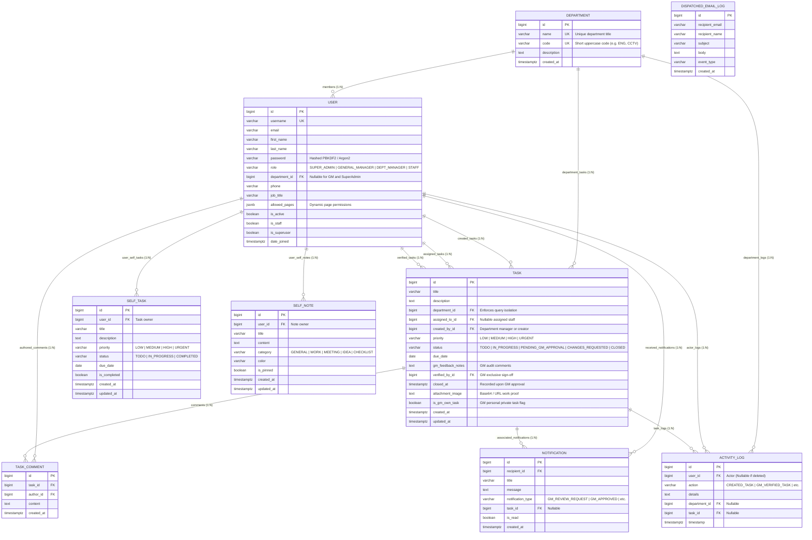
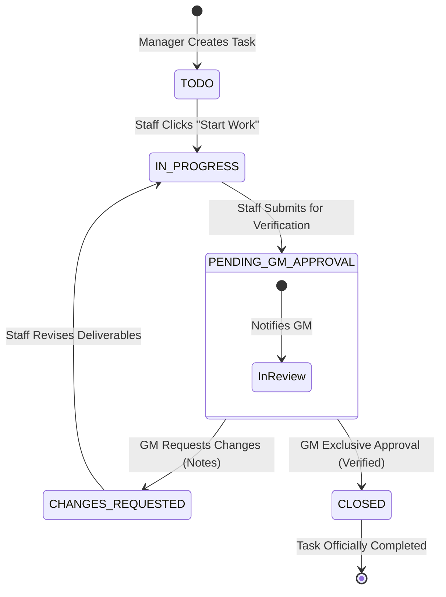

# PostgreSQL 18 Database Schema & Entity-Relationship (ER) Diagram

**System:** Enterprise Multi-Department Task Tracker  
**Database Engine:** PostgreSQL 18 (`localhost:5432 / task_tracker_db`)  
**Backend Framework:** Django 6.0 + Django REST Framework (DRF)

---

## 1. Visual Entity-Relationship (ER) Diagram

---

## 2. Table Specifications & Data Dictionary

### Table: `tasks_department` (Departments)
Autonomous enterprise business units with backend-enforced query isolation.

| Column | Data Type | Nullable | Constraints / Description |
| :--- | :--- | :---: | :--- |
| `id` | `BIGSERIAL` | ❌ No | **Primary Key** |
| `name` | `VARCHAR(100)` | ❌ No | **UNIQUE** - Department full title (e.g. `CCTV & Surveillance`) |
| `code` | `VARCHAR(10)` | ❌ No | **UNIQUE** - Uppercase identifier code (e.g. `CCTV`, `ENG`, `MKT`) |
| `description` | `TEXT` |  Yes | Functional scope and operational duties |
| `created_at` | `TIMESTAMPTZ` | ❌ No | Auto timestamp when department was provisioned |

---

### Table: `tasks_user` (Enterprise Users & RBAC)
Extends Django's `AbstractUser` with enterprise role-based access control (RBAC).

| Column | Data Type | Nullable | Constraints / Description |
| :--- | :--- | :---: | :--- |
| `id` | `BIGSERIAL` | ❌ No | **Primary Key** |
| `username` | `VARCHAR(150)` | ❌ No | **UNIQUE** - Account login identifier |
| `password` | `VARCHAR(128)` | ❌ No | Cryptographically salted PBKDF2 hash |
| `email` | `VARCHAR(254)` |  Yes | Notifications dispatch email |
| `first_name` | `VARCHAR(150)` |  Yes | User given name |
| `last_name` | `VARCHAR(150)` |  Yes | User surname |
| `role` | `VARCHAR(20)` | ❌ No | Role enum: `SUPER_ADMIN`, `GENERAL_MANAGER`, `DEPT_MANAGER`, `STAFF` |
| `department_id` | `BIGINT` |  Yes | **Foreign Key** (`tasks_department.id`, `ON DELETE SET NULL`) |
| `job_title` | `VARCHAR(100)` |  Yes | Corporate designation (e.g. `Surveillance Monitoring Officer`) |
| `phone` | `VARCHAR(25)` |  Yes | Contact phone number |
| `allowed_pages` | `JSONB` | ❌ No | Accessible pages list (e.g. `['board', 'table', 'self_desk']`) |
| `is_active` | `BOOLEAN` | ❌ No | Default `TRUE` |
| `is_staff` | `BOOLEAN` | ❌ No | Django admin panel access flag |
| `is_superuser` | `BOOLEAN` | ❌ No | Full system bypass flag |
| `date_joined` | `TIMESTAMPTZ` | ❌ No | Account creation timestamp |

---

### Table: `tasks_task` (Departmental Tasks)
Core tracking entity with departmental query scoping and exclusive GM verification.

| Column | Data Type | Nullable | Constraints / Description |
| :--- | :--- | :---: | :--- |
| `id` | `BIGSERIAL` | ❌ No | **Primary Key** |
| `title` | `VARCHAR(255)` | ❌ No | Task deliverable summary |
| `description` | `TEXT` |  Yes | Full technical specifications |
| `department_id` | `BIGINT` | ❌ No | **Foreign Key** (`tasks_department.id`, `ON DELETE CASCADE`) |
| `assigned_to_id` | `BIGINT` |  Yes | **Foreign Key** (`tasks_user.id`, `ON DELETE SET NULL`) |
| `created_by_id` | `BIGINT` | ❌ No | **Foreign Key** (`tasks_user.id`, `ON DELETE CASCADE`) |
| `priority` | `VARCHAR(20)` | ❌ No | Enum: `LOW`, `MEDIUM`, `HIGH`, `URGENT` (Default: `MEDIUM`) |
| `status` | `VARCHAR(30)` | ❌ No | State machine: `TODO`, `IN_PROGRESS`, `PENDING_GM_APPROVAL`, `CHANGES_REQUESTED`, `CLOSED` |
| `due_date` | `DATE` |  Yes | Completion target date |
| `gm_feedback_notes` | `TEXT` |  Yes | Audit remarks entered by General Manager |
| `verified_by_id` | `BIGINT` |  Yes | **Foreign Key** (`tasks_user.id`, `ON DELETE SET NULL`) - GM sign-off |
| `closed_at` | `TIMESTAMPTZ` |  Yes | Populated exclusively upon GM sign-off |
| `attachment_image`| `TEXT` |  Yes | Base64 string or image URL proof |
| `is_gm_own_task` | `BOOLEAN` | ❌ No | GM personal private task flag (Default: `FALSE`) |
| `created_at` | `TIMESTAMPTZ` | ❌ No | Creation timestamp |
| `updated_at` | `TIMESTAMPTZ` | ❌ No | Last modified timestamp |

---

### Table: `tasks_taskcomment` (Discussion & Audit Notes)
Threaded task collaboration notes and lifecycle comments.

| Column | Data Type | Nullable | Constraints / Description |
| :--- | :--- | :---: | :--- |
| `id` | `BIGSERIAL` | ❌ No | **Primary Key** |
| `task_id` | `BIGINT` | ❌ No | **Foreign Key** (`tasks_task.id`, `ON DELETE CASCADE`) |
| `author_id` | `BIGINT` | ❌ No | **Foreign Key** (`tasks_user.id`, `ON DELETE CASCADE`) |
| `content` | `TEXT` | ❌ No | Comment text |
| `created_at` | `TIMESTAMPTZ` | ❌ No | Auto timestamp |

---

### Table: `tasks_notification` (In-App Notification Center)
Real-time alerts delivered to users on task status transitions.

| Column | Data Type | Nullable | Constraints / Description |
| :--- | :--- | :---: | :--- |
| `id` | `BIGSERIAL` | ❌ No | **Primary Key** |
| `recipient_id` | `BIGINT` | ❌ No | **Foreign Key** (`tasks_user.id`, `ON DELETE CASCADE`) |
| `title` | `VARCHAR(255)` | ❌ No | Alert title |
| `message` | `TEXT` | ❌ No | Detailed notification body |
| `notification_type` | `VARCHAR(50)` | ❌ No | Type tag (`GM_REVIEW_REQUEST`, `TASK_ASSIGNED`, etc.) |
| `task_id` | `BIGINT` |  Yes | **Foreign Key** (`tasks_task.id`, `ON DELETE CASCADE`) |
| `is_read` | `BOOLEAN` | ❌ No | Default `FALSE` |
| `created_at` | `TIMESTAMPTZ` | ❌ No | Timestamp |

---

### Table: `tasks_dispatchedemaillog` (Outbound Email Log)
Audit log of all system emails dispatched on task events.

| Column | Data Type | Nullable | Constraints / Description |
| :--- | :--- | :---: | :--- |
| `id` | `BIGSERIAL` | ❌ No | **Primary Key** |
| `recipient_email` | `VARCHAR(255)` | ❌ No | Recipient destination email |
| `recipient_name` | `VARCHAR(255)` |  Yes | Full name of recipient |
| `subject` | `VARCHAR(255)` | ❌ No | Email subject line |
| `body` | `TEXT` | ❌ No | Full email content |
| `event_type` | `VARCHAR(50)` | ❌ No | Event trigger tag |
| `created_at` | `TIMESTAMPTZ` | ❌ No | Timestamp dispatched |

---

### Table: `tasks_activitylog` (Enterprise Audit Trail)
Append-only tamper-evident compliance audit trail.

| Column | Data Type | Nullable | Constraints / Description |
| :--- | :--- | :---: | :--- |
| `id` | `BIGSERIAL` | ❌ No | **Primary Key** |
| `user_id` | `BIGINT` |  Yes | **Foreign Key** (`tasks_user.id`, `ON DELETE SET NULL`) |
| `action` | `VARCHAR(100)` | ❌ No | Action identifier (e.g. `CREATED_TASK`, `GM_VERIFIED_TASK`) |
| `details` | `TEXT` | ❌ No | Human-readable event description |
| `department_id` | `BIGINT` |  Yes | **Foreign Key** (`tasks_department.id`, `ON DELETE SET NULL`) |
| `task_id` | `BIGINT` |  Yes | **Foreign Key** (`tasks_task.id`, `ON DELETE SET NULL`) |
| `timestamp` | `TIMESTAMPTZ` | ❌ No | Timestamp |

---

### Table: `tasks_selftask` (Personal Self Desk Tasks)
User-level private task checklist for individual organization and self-work.

| Column | Data Type | Nullable | Constraints / Description |
| :--- | :--- | :---: | :--- |
| `id` | `BIGSERIAL` | ❌ No | **Primary Key** |
| `user_id` | `BIGINT` | ❌ No | **Foreign Key** (`tasks_user.id`, `ON DELETE CASCADE`) - Task owner |
| `title` | `VARCHAR(255)` | ❌ No | Self task summary |
| `description` | `TEXT` |  Yes | Task details / notes |
| `priority` | `VARCHAR(20)` | ❌ No | `LOW`, `MEDIUM`, `HIGH`, `URGENT` (Default: `MEDIUM`) |
| `status` | `VARCHAR(20)` | ❌ No | `TODO`, `IN_PROGRESS`, `COMPLETED` (Default: `TODO`) |
| `due_date` | `DATE` |  Yes | Personal target date |
| `is_completed` | `BOOLEAN` | ❌ No | Completion toggle (Default: `FALSE`) |
| `created_at` | `TIMESTAMPTZ` | ❌ No | Creation timestamp |
| `updated_at` | `TIMESTAMPTZ` | ❌ No | Modification timestamp |

---

### Table: `tasks_selfnote` (Personal Memos & Quick Notes)
Sticky notes, project ideas, checklists, and scratch notes personal to each user.

| Column | Data Type | Nullable | Constraints / Description |
| :--- | :--- | :---: | :--- |
| `id` | `BIGSERIAL` | ❌ No | **Primary Key** |
| `user_id` | `BIGINT` | ❌ No | **Foreign Key** (`tasks_user.id`, `ON DELETE CASCADE`) - Note owner |
| `title` | `VARCHAR(255)` | ❌ No | Note headline / subject |
| `content` | `TEXT` |  Yes | Detailed body or markdown checklist |
| `category` | `VARCHAR(30)` | ❌ No | `GENERAL`, `WORK`, `MEETING`, `IDEA`, `CHECKLIST` |
| `color` | `VARCHAR(30)` |  Yes | Visual sticky card color theme |
| `is_pinned` | `BOOLEAN` | ❌ No | Pin to top toggle (Default: `FALSE`) |
| `created_at` | `TIMESTAMPTZ` | ❌ No | Creation timestamp |
| `updated_at` | `TIMESTAMPTZ` | ❌ No | Modification timestamp |

---

## 3. Task State Transition Diagram

---

## 4. Referential Integrity & Cascade Rules

1. **Department Deletion (`Department` &rarr; `Task` / `User`)**:
   * Deleting a Department **cascades** and removes its associated Tasks (`ON DELETE CASCADE`).
   * Members of that Department remain in the system with `department_id = NULL` (`ON DELETE SET NULL`).
2. **User Deletion (`User` &rarr; `Task`)**:
   * If an assignee leaves the organization, `assigned_to` becomes `NULL` (`ON DELETE SET NULL`) to retain task history.
   * If a creator is deleted, tasks cascade (`ON DELETE CASCADE`).
   * If a verifying GM is removed, `verified_by` becomes `NULL` (`ON DELETE SET NULL`) while preserving `closed_at` and `gm_feedback_notes`.
3. **Task Deletion (`Task` &rarr; `Comments` / `Notifications` / `Audit`)**:
   * Comments and Notifications are strictly bound to tasks and cascade (`ON DELETE CASCADE`).
   * Activity logs preserve the action history with `task_id = NULL` (`ON DELETE SET NULL`).
